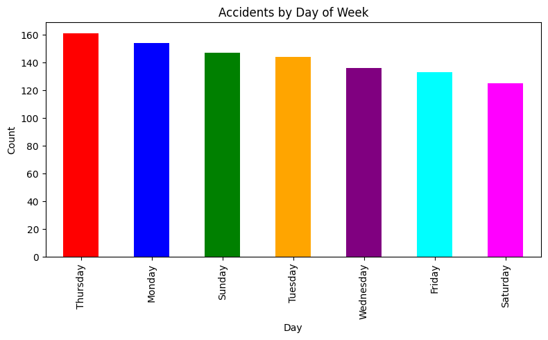
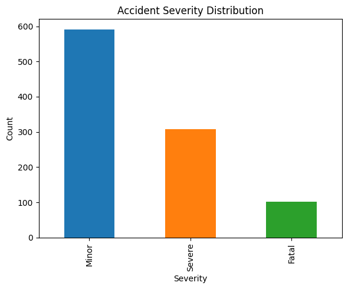
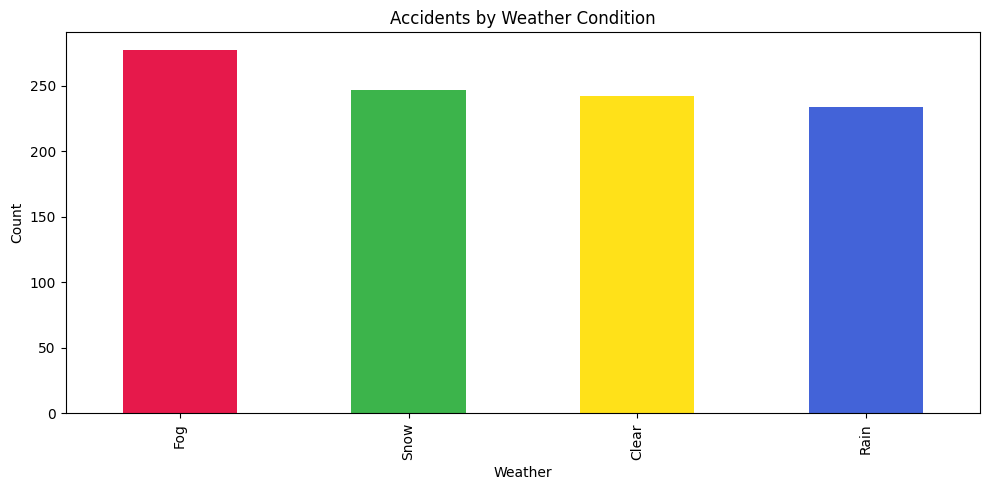
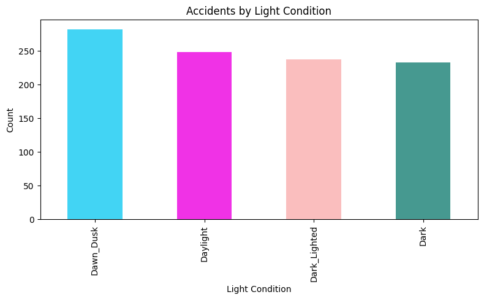

# 🚦 Traffic Accident Hotspot Analysis

<p align="center">
  <strong>Exploratory analysis of traffic accident patterns across time, road types, weather, lighting, and severity.</strong>
</p>

<p align="center">
  
  
  
  
</p>

---

## 📌 Project overview

Traffic accidents are influenced by multiple conditions, including when an incident occurs, the type of road, weather, surface conditions, and visibility. This project explores a structured traffic-accident dataset and visualises patterns that can support further road-safety investigation.

The analysis currently focuses on four questions:

- Which days of the week have the most recorded accidents?
- How are accidents distributed by severity?
- Which weather conditions appear most often in the dataset?
- How are accidents distributed across lighting conditions?

> **Dataset note:** The repository contains a 1,000-row CSV covering records dated 2023–2024. Treat it as the supplied analysis dataset; its provenance and representativeness have not been independently verified. The charts describe this dataset, not official nationwide accident totals.

## ✨ Highlights

| Dataset snapshot | Value |
|---|---:|
| Accident records | **1,000** |
| Fields | **11** |
| Date range in file | **2023–2024** |
| Severity categories | **3** |
| Weather categories | **4** |
| Road categories | **3** |

### Severity distribution

| Severity | Records | Share |
|---|---:|---:|
| Minor | 591 | 59.1% |
| Severe | 308 | 30.8% |
| Fatal | 101 | 10.1% |

### Questions explored

- **Time patterns:** weekday distribution
- **Severity:** Minor, Severe, and Fatal categories
- **Weather:** Clear, Rain, Fog, and Snow
- **Lighting:** Daylight, Dawn/Dusk, Dark, and Dark with street lighting

## 📊 Visual results

The repository includes the chart exports generated for this analysis:

| Chart | Preview |
|---|---|
| Accidents by day of week |  |
| Accident severity distribution |  |
| Accidents by weather condition |  |
| Accidents by light condition |  |

## 🧰 Tech stack

- **Python** — analysis
- **Pandas** — CSV loading and aggregation
- **Matplotlib** — chart generation
- **Jupyter Notebook** — reproducible, step-by-step exploration

## 📁 Repository structure

```text
.
├── Task2.ipynb
├── usa_traffic_accidents_2023_2024_1000.csv
├── task2graph1.png
├── task2graph2.png
├── task2graph3.png
├── task2graph4.png
├── requirements.txt
└── README.md
```

## 🚀 Run the project locally

### 1. Clone the repository

```bash
git clone https://github.com/salianvikram/-Traffic-Accident-Hotspot-Analysis-.git
cd -Traffic-Accident-Hotspot-Analysis-
```

### 2. Create and activate a virtual environment

**Windows PowerShell**
```powershell
python -m venv .venv
.\.venv\Scripts\Activate.ps1
```

**macOS / Linux**
```bash
python3 -m venv .venv
source .venv/bin/activate
```

### 3. Install dependencies

```bash
pip install -r requirements.txt
```

### 4. Launch the notebook

```bash
jupyter notebook Task2.ipynb
```

Run the cells in order. Keep the CSV in the same directory as the notebook.

## 🗂️ Dataset fields

| Field | Description |
|---|---|
| `Accident_ID` | Record identifier |
| `Date`, `Time` | Accident date and time |
| `Day_of_Week` | Day of the week |
| `Road_Type` | Rural, Urban, or Highway |
| `Surface_Condition` | Dry, Wet, or Snow |
| `Weather_Condition` | Clear, Rain, Fog, or Snow |
| `Light_Condition` | Daylight, Dawn/Dusk, Dark, or Dark_Lighted |
| `Accident_Severity` | Minor, Severe, or Fatal |
| `Latitude`, `Longitude` | Coordinate fields supplied with each record |

## 🔭 Future improvements

- Add an interactive map to inspect geographic clusters and potential hotspots.
- Use geospatial clustering (for example, DBSCAN) to identify dense groups of incidents.
- Add time-of-day, monthly, and seasonal trend analysis.
- Compare severity against weather, road, surface, and lighting conditions.
- Add data validation, missing-value checks, and reproducible analysis scripts.
- Document the dataset source and methodology before drawing real-world conclusions.

## ⚠️ Scope and limitations

This is an exploratory data-analysis project, not a validated crash-prediction or causal-inference model. A geographic hotspot analysis requires checking coordinate quality, geographic coverage, duplicate records, and the dataset's source. Counts and percentages should not be interpreted as population-level risk without exposure data (such as traffic volume) and a representative source.

## 👨‍💻 Author

**Vikram K. Salian**

- GitHub: [@salianvikram](https://github.com/salianvikram)

---

<p align="center">
  If you find this project useful, consider giving it a ⭐
</p>
